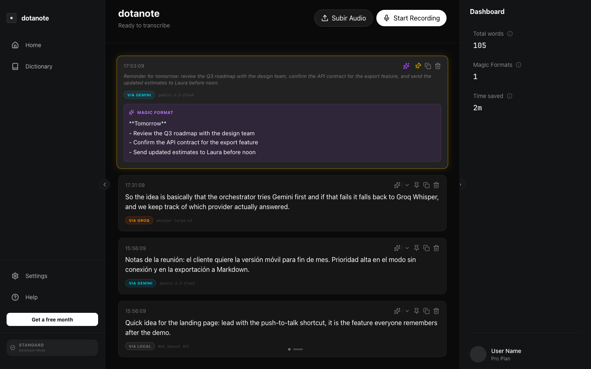
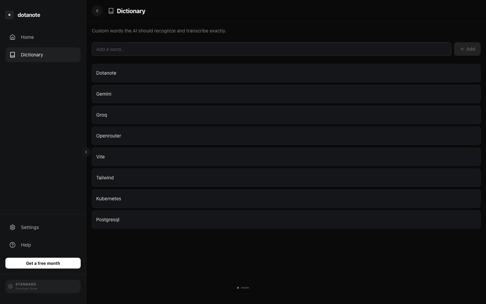
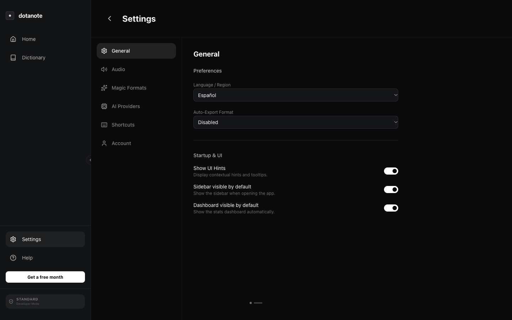
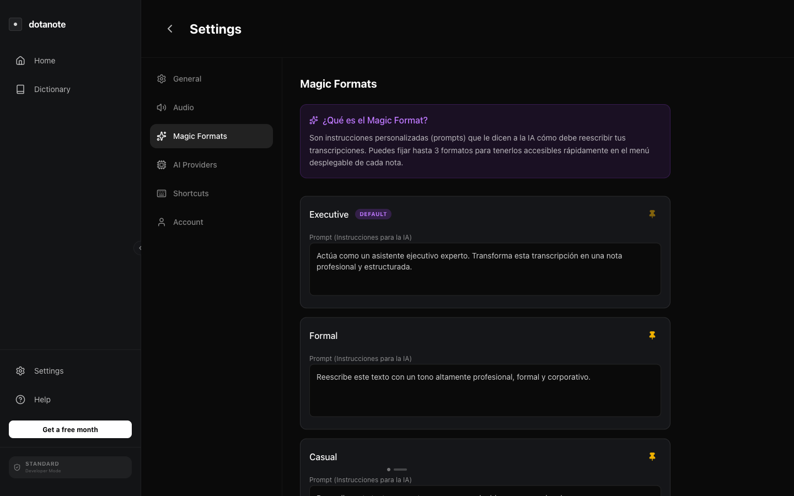

# dotanote

Voice transcription app combining speech-to-text with LLM-powered text enhancement




_Screenshots use sample transcription history and vocabulary for demonstration._

---

## Features

### Transcription

- **Cloud transcription** — Whisper via Groq or audio transcription with Gemini.
- **Browser speech recognition** — uses the Web Speech API where supported. This does not guarantee on-device or offline processing.
- **Recording controls** — floating panel with an audio visualizer and language selection.
- **Languages** — English, Spanish, French, Portuguese, and automatic language detection for cloud transcription.

### Text Enhancement (Magic Format)

- **LLM-based rewriting** — turn a transcript into a note, summary, or message.
- **Custom prompts** — define instructions for tone, structure, or wording.
- **Optional auto-copy** — copy transcriptions and enhanced text to the clipboard when enabled.

### Audio Settings

- **Microphone options** — request noise suppression and automatic gain control through browser audio constraints. Support depends on the browser and device.
- **Device selection** — microphone and speaker selection controls in settings.
- **Audio visualizer** — displays audio levels while recording.

### AI Providers

- **Transcription** — Groq and Gemini integrations.
- **Text enhancement** — Anthropic, Qwen, Gemini, Groq, and OpenRouter integrations.
- **Sequential fallback** — tries the next configured provider when a request fails.
- **Model attribution** — records the provider and model returned with a result; enhancement updates this information to the model used for rewriting.

### Keyboard Shortcuts

| Shortcut       | Action                       |
| -------------- | ---------------------------- |
| `Ctrl + Space` | Toggle recording             |
| `Cmd/Ctrl + J` | Toggle sidebar               |
| `Cmd/Ctrl + L` | Toggle stats dashboard       |
| `Cmd/Ctrl + K` | Focus mode (hide all panels) |
| `Alt + Z`      | Push-to-talk                 |

---

## Screenshots

| Dictionary                                                       | Settings                                           |
| ---------------------------------------------------------------- | -------------------------------------------------- |
|  |  |

### Magic Formats



---

## Tech Stack

| Area        | Technology                     |
| ----------- | ------------------------------ |
| Language    | TypeScript                     |
| UI          | React                          |
| Development | Vite, Node.js, pnpm            |
| Styling     | Tailwind CSS                   |
| Animations  | Motion                         |
| Icons       | lucide-react                   |
| Testing     | Vitest, Testing Library, jsdom |
| Linting     | ESLint                         |
| Formatting  | Prettier                       |

---

## Getting Started

### Prerequisites

- Node.js and pnpm
- A supported browser with microphone access for recording
- An API key for at least one cloud provider to use cloud transcription or text enhancement

### Setup

```bash
git clone https://github.com/Sebastianlopez-dev/dotanote.git
cd dotanote
pnpm install
pnpm dev
```

Open `http://localhost:3000`.

To use cloud providers, enter your keys in **Settings → AI Providers** with custom keys enabled. Alternatively, create `.env.local` in the project root with either or both of these variables:

```dotenv
VITE_GEMINI_API_KEY="your-gemini-key"
VITE_GROQ_API_KEY="your-groq-key"
```

Restart the development server after changing `.env.local`. These environment keys are used when custom keys are disabled.

Vite exposes `VITE_` variables to browser code. Do not deploy a public build containing private API keys. Cloud providers receive the audio or text submitted to them.

### Available Scripts

| Command           | Description              |
| ----------------- | ------------------------ |
| `pnpm dev`        | Start development server |
| `pnpm build`      | Build the app            |
| `pnpm preview`    | Preview the built app    |
| `pnpm test`       | Run tests                |
| `pnpm test:watch` | Run tests in watch mode  |
| `pnpm lint`       | Run ESLint               |
| `pnpm format`     | Format source files      |
| `pnpm type-check` | Check TypeScript types   |

---

## Testing

Tests live in `src/test/` and use Vitest, Testing Library, and jsdom. They cover error-boundary recovery, settings persistence, transcription history, format selection, and provider fallback.

```bash
# Run tests
pnpm test

# Run a single test file
pnpm exec vitest run src/test/error-boundary.test.tsx

# Watch mode
pnpm test:watch

# Type checking
pnpm type-check
```

---

## Project Structure

```text
src/
├── App.tsx                # App state and UI coordination
├── main.tsx               # Entry point
├── types.ts               # Shared TypeScript interfaces
├── components/            # Recording, transcription, settings, and other UI
├── services/
│   ├── AIOrchestrator.ts  # Provider selection and sequential fallback
│   ├── transcription.ts  # Browser speech recognition wrapper
│   └── providers/         # Provider integrations
├── lib/                   # History, settings, dictionary, and format helpers
└── test/                  # Tests and test setup
```

---

## Architecture

`App.tsx` manages application state and coordinates recording, transcription, and text enhancement. Provider integrations share an `AIProvider` interface with `transcribe` and `enhance` methods.

`AIOrchestrator` builds separate provider lists for transcription and enhancement from the available keys. Their order is defined in its constructor:

- **Transcription:** Groq → Gemini.
- **Enhancement:** Anthropic → Qwen → Gemini → Groq → OpenRouter.

For each request, it tries providers in sequence and returns the first successful response. If all configured providers fail, it throws the last error. If none are configured, it reports that no providers are available. This is sequential fallback, not a circuit breaker.

Browser speech recognition uses a separate `LocalTranscriber` wrapper around the Web Speech API. Despite the class name, processing is not guaranteed to happen locally.

---

## License

MIT
